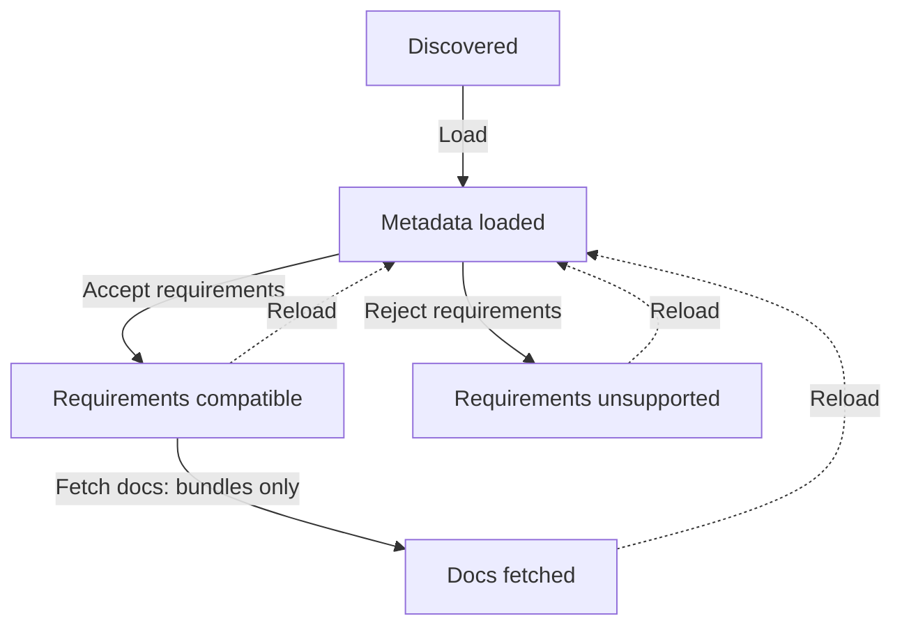

# Package workflow

PHP and Symfony compatibility are results of one requirements check, not separate
processing stages. Every package checks its declared constraints, including libraries
that depend on Symfony core. No relevant constraint means not applicable and does
not block processing. See [the native workflow guide](../native-workflow.md).
